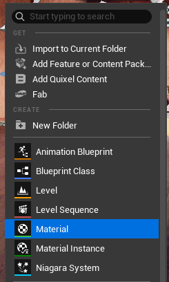
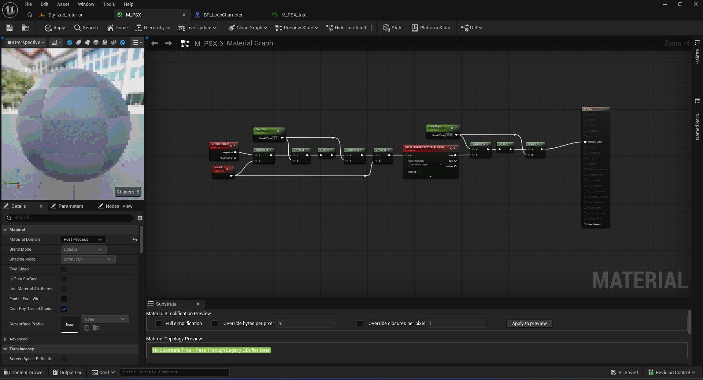
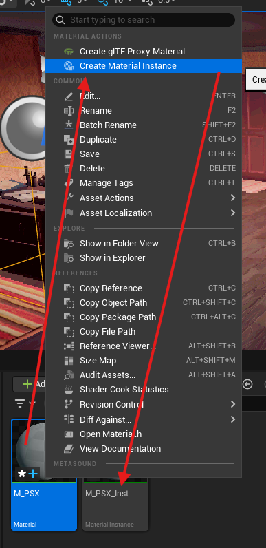
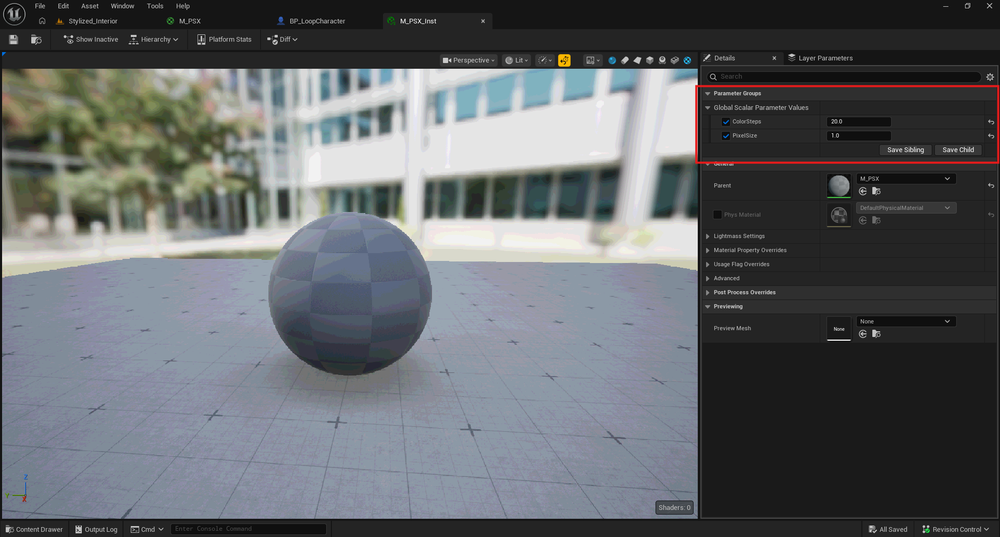
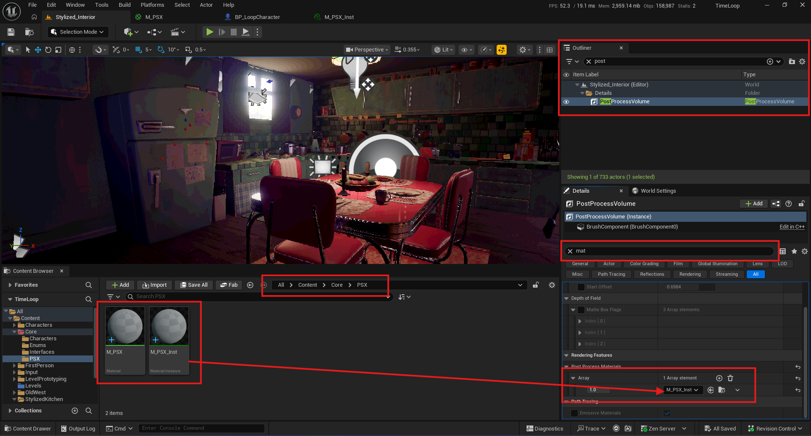

# Postprocessing

### P1 Style

### 1. Create Material from content browser: M_PSX

|||
|---|---|

### 2. Create Material instance from the M_PSX -> M_PSX. e can also configure the Values

|||
|---|---|

### 3. Apply them to the PostProcessingVolume under the Material Attachment.

