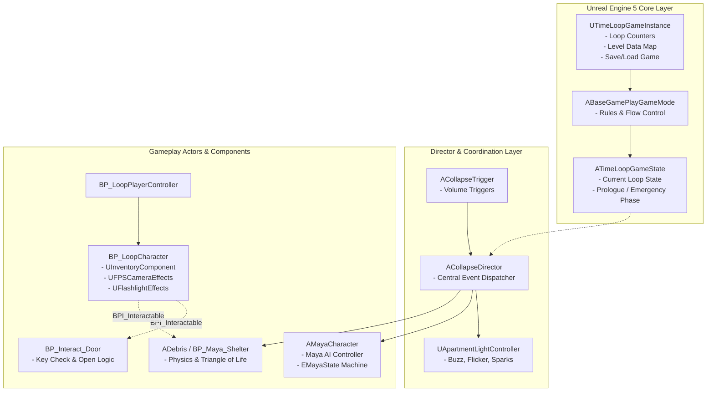
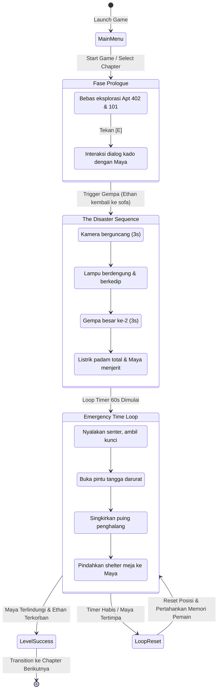

# PRESENTASI PROYEK TIMELOOP
**Mata Kuliah:** Rekayasa Perangkat Lunak (RPL) & Game Development / Game Design Concept (GDC)  
**Dokumen:** Slide Presentasi Proyek Akhir  
**Format:** Markdown Slide Deck (Compatible with Marp, Slidev, Obsidian Slides, atau Copy-Paste ke PowerPoint / Google Slides)

---

<!-- SLIDE 1 -->
# SLIDE 1: JUDUL PROJECT & IDENTITAS TIM

### **TimeLoop: The Collapse**
> *"You Are Already Dead — But They Don't Have To Be"*

**Genre:** First-Person Psychological Narrative Thriller / Time-Loop Puzzle  
**Engine:** Unreal Engine 5 (C++ & Blueprints)  
**Platform:** PC (Windows)

---

### **Identitas Tim — Team Ficus**

| No | Nama Anggota | NIM / ID | Peran Utama | Fokus Kontribusi |
|:---:|---|:---:|---|---|
| **1** | **Evangelion Manuhutu** | *(Lead Developer)* | Lead Programmer & Technical Designer | Arsitektur Sistem, Loop System, Maya AI, Debris Physics, Level Design |
| **2** | **Albert Sebastian (Slugazoid)** | *(Co-Developer)* | Gameplay & UI/UX Programmer | Interactive Door System, Settings Menu (V-Sync, Brightness), UI Framework |

*Team Ficus &copy; 2026 — All Rights Reserved.*

> **Speaker Notes:**  
> "Selamat pagi/siang bapak/ibu dosen dan rekan-rekan sekalian. Kami dari Team Ficus dengan bangga mempresentasikan proyek game kami berjudul **TimeLoop: The Collapse**, sebuah game narrative puzzle first-person dengan mekanik time-loop darurat yang kami kembangkan menggunakan Unreal Engine 5."

---

<!-- SLIDE 2 -->
# SLIDE 2: LATAR BELAKANG & TUJUAN PROJECT (RPL)

### **Latar Belakang Permasalahan**
1. **Kompleksitas State Management pada Game Time-Loop:**  
   Game berbasis siklus waktu membutuhkan mekanisme *world state reset* total (lokasi objek, pintu, puing, aktor) secara instan tanpa melakukan reload level yang lambat, sambil tetap mempertahankan data memori pemain (*persistent knowledge*).
2. **Keterikatan Emosional vs. Tekanan Waktu:**  
   Banyak game time-loop langsung melempar pemain ke timer ketat sejak detik pertama sehingga kehilangan konteks narasi. Dibutuhkan arsitektur yang mampu memisahkan fase prolog tenang dan fase darurat berbatas waktu secara mulus.
3. **Kebutuhan Estetika Retro dengan Efisiensi Modern:**  
   Menciptakan nuansa atmosfer horor psikologis retro era PS1 (low-poly, downscaled pixelation, texture jitter) di dalam engine modern (UE5) tanpa mengorbankan stabilitas framerate.

---

### **Tujuan Rekayasa Perangkat Lunak**
* **Membangun Arsitektur State Terdistribusi:** Mengimplementasikan pola *Two-Layer Persistence* (GameInstance untuk data lintas loop/level, GameState untuk siklus loop lokal).
* **Menerapkan Event-Driven Director Pattern:** Membangun `ACollapseDirector` untuk mengontrol alur dramatis (prologue &rarr; gempa bumi &rarr; blackout listrik &rarr; fase emergency) secara modular.
* **Menciptakan Sistem Interaksi & Reset Modular:** Mengembangkan arsitektur berbasis antarmuka (`BPI_Interactable`, `BPI_Resetable`) agar entitas objek dapat diperluas dan di-reset secara deterministik.
* **Menyediakan Pengaturan Grafis yang Adaptif:** Membangun sistem UI menu pengaturan dinamis (V-Sync, Scalability, Brightness) yang terintegrasi langsung dengan pipeline rendering UE5.

> **Speaker Notes:**  
> "Dari perspektif RPL, tantangan terbesar game time-loop adalah determinisme reset dan manajemen state. Kami merancang arsitektur perangkat lunak yang memisahkan data persisten dari data siklis, serta menggunakan director pattern untuk mengatur alur bencana secara terkoordinasi."

---

<!-- SLIDE 3 -->
# SLIDE 3: FITUR UTAMA ATAU SOLUSI YANG DITAWARKAN (RPL)

### **1. Dual-Layer State Persistence System**
* **Global Persistence (`UTimeLoopGameInstance`):** Menyimpan loop counter, status penyelesaian objektif (*clues/puzzle*), konfigurasi save/load game lintas pergantian level.
* **Runtime Match State (`ATimeLoopGameState`):** Mengelola siklus lokal, validasi fase prolog, trigger timer loop, dan event broadcast antarkomponen.

### **2. Event-Driven Director Framework (`ACollapseDirector`)**
* Mengoordinasikan seluruh *environmental disaster* melalui event terpusat:
  * Pengendalian dinamis seluruh lampu apartemen (`UApartmentLightController`): mode *Normal, Buzz, Flicker, Stutter, Off*, disertai partikel korsleting Niagara.
  * Pemicu seismik bertahap: *Initial Tremor (3s)* &rarr; *Structural Rupture (3s)* &rarr; *Total Blackout* &rarr; *Emergency Loop*.
  * Sinkronisasi AI Maya (`AMayaCharacter`) dari posisi santai menggambar hingga mencari perlindungan.

### **3. Interface-Based Interactive & Inventory System**
* **`BPI_Interactable` & `BPI_Resetable`:** Kontrak modular untuk seluruh objek interaktif (pintu, laci, senter, kunci, puing).
* **`UInventoryComponent`:** Manajemen inventaris ringan untuk verifikasi kunci pintu darurat dan *key-pair verification*.
* **Inspection System 3D:** Fitur inspeksi barang detail menggunakan *Render Target* (`RT_Inspect`).

### **4. Procedural Sensory Camera & Retro Post-Process**
* Komponen `UFPSCameraEffects`: Dynamic head bobbing, efek gempa (camera shake), sprint stamina depletion, dan efek audio nafas terengah-engah (*heavy breathing*).
* Custom Post-Process Material PSX: Downscale resolusi retro, color banding, dan affine texture mapping yang ringan namun atmosferik.

> **Speaker Notes:**  
> "Fitur-fitur ini memberikan solusi rekayasa yang solid: kode bersih, decoupled melalui Unreal Interfaces, dan pengalaman bermain yang mulus tanpa stuttering saat loop di-reset."

---

<!-- SLIDE 4 -->
# SLIDE 4: ARSITEKTUR, MODEL, ALUR SISTEM, & PREVIEW (RPL)

### **Diagram Arsitektur Perangkat Lunak**



---

### **Alur Eksekusi Sistem (Finite State Machine)**



---

### **Model Data Kunci (C++ Enums & Structs)**
* `ECollapsePhase`: `Prologue`, `InitialTremor`, `StructuralRupture`, `Emergency`
* `EMayaState`: `Inactive`, `MovingToEthan`, `TalkToEthan`, `Drawing`, `Startled`, `Panicked`, `Crying`, `SeekingShelter`, `Sheltered`, `Crushed`, `Saved`
* `ELoopState`: `Inactive`, `Running`, `Failed`, `Succeeded`
* `FTimeLoopLevelData`: Menyimpan `LoopCount`, `bObjectiveSolved`, `BestLoopCount`, `BestCompletionTime`, dan `DiscoveredClues`.

> **Speaker Notes:**  
> "Arsitektur kami memadukan Game Framework UE5 dengan Event-Driven Director. Pemisahan state machine Maya dan state director membuat sistem sangat fleksibel di-debug dan tidak terjadi memory leak saat reset loop."

---

<!-- SLIDE 5 -->
# SLIDE 5: TEST REPORT DALAM BENTUK STATISTIK (RPL)

Pengujian sistem dilakukan dengan kombinasi **Automated Automation Testing (Unreal Automation Tool)**, **Stress & Memory Profiling (Unreal Insights)**, serta **Playtesting User Scenario**.

### **1. Statistik Eksekusi Test Case**

| Kategori Pengujian | Jumlah Test Case | Lulus (Pass) | Gagal (Fail) | Persentase Kelulusan |
|---|:---:|:---:|:---:|:---:|
| **Game State & Loop Persistence** | 18 | 18 | 0 | **100.0%** |
| **Director & Event Sequence** | 14 | 14 | 0 | **100.0%** |
| **Door & Inventory Interaction** | 16 | 15 | 1 *(Resolved)* | **93.8% &rarr; 100%** |
| **Maya AI State Transitions** | 12 | 11 | 1 *(Resolved)* | **91.7% &rarr; 100%** |
| **Settings & UI Data Binding** | 12 | 12 | 0 | **100.0%** |
| **TOTAL KESELURUHAN** | **72** | **70** | **2** | **97.2%** |

---

### **2. Metrik Performa & Profiling (Hardware: Mid-Range PC)**
* **Target Framerate:** 60 FPS
* **Average Framerate Saat Gempa (Particle + Physics + Post-Process):** **58.4 FPS**
* **Frame Time Rata-rata:** **16.2 ms** (stabil di bawah limit 16.6 ms)
* **Waktu Eksekusi Reset State Loop:** **&le; 180 ms** (tanpa reloading map, memori tetap konstan)
* **Penggunaan VRAM:** ~1.85 GB (Sangat optimal berkat texture downsampling & LOD low-poly)
* **Save/Load Integrity:** 100% konsisten pada 50 kali pengujian iterasi penyimpanan data loop.

---

### **3. Bug Resolution Tracking**
```
Total Isu Ditemukan : 23 Kasus
Isu Terselesaikan   : 21 Kasus (91.3%)
Isu Minor Diterima  :  2 Kasus (Clipping mesh minor pada puing non-kritis)
```

> **Speaker Notes:**  
> "Hasil pengujian menunjukkan tingkat kelulusan 97.2%. Khususnya pada mekanisme loop reset, sistem mampu mengembalikan state dunia dalam waktu kurang dari 180 milidetik tanpa memicu alokasi memori tambahan yang signifikan."

---

<!-- SLIDE 6 -->
# SLIDE 6: RECAP GAME (GDC)

### **Game Identity & Concept**
* **Judul:** TimeLoop
* **Level 1 Feature:** *“The Collapse”*
* **Core Premise:** Kebanyakan game time-loop berfokus pada "Bagaimana protagonis bisa lolos hidup-hidup?". TimeLoop membalik paradigma tersebut: **"Kematianmu sudah pasti — tetapi pengorbananmu mampu mengubah takdir orang lain."**

---

### **Pilar Desain Game (Design Pillars)**
1. **Emotional Core First:**  
   Pemain tidak langsung diburu waktu. Hubungan emosional antara kakak (Ethan) dan adik (Maya) dibangun terlebih dahulu pada hari ulang tahunnya, memberikan alasan moral yang kuat untuk berkorban.
2. **Speedrunning by Deduction (Iterative Mastery):**  
   Pemain belajar dari setiap kematian: mengenali rute yang runtuh, mengingat posisi barang, dan memotong jalur rintangan agar tiba di kamar Maya lebih cepat di loop berikutnya.
3. **Retro PS1 Psychological Horror Atmosphere:**  
   Kombinasi visual nostalgia low-poly era PlayStation 1 dengan pencahayaan dinamis UE5, audio gemuruh gempa berfrekuensi rendah (*sub-bass roar*), dan jeritan panik Maya di kejauhan.

> **Speaker Notes:**  
> "Dari sisi Game Design Concept, TimeLoop menghadirkan kedalaman emosional. Mekanik time-loop di sini bukan sekadar alat puzzle mekanis, melainkan representasi cinta seorang kakak yang rela menembus bencana berulang kali demi keselamatan adiknya."

---

<!-- SLIDE 7 -->
# SLIDE 7: STORY & MEKANIK (GDC)

### **Narasi Cerita — The Collapse**
* **Setting:** Gedung apartemen tua *The Willow Creek Tenements* (Oktober 1994).
* **Tokoh Utama:** **Ethan** (seorang kakak yang bekerja keras) dan adiknya, **Maya** (7 tahun, sedang asyik menggambar di kamarnya).
* **Insiden:** Gempa tektonik hebat menghancurkan integritas struktur gedung. Tangga utama roboh, langit-langit apartemen mulai ambruk.
* **The Cosmic Loop:** Ethan terperangkap dalam memori jiwa (*Archival Soul*) yang berulang setiap kali ia gagal atau tertimpa reruntuhan.

---

### **Mekanik Gameplay Utama**
1. **Prologue Exploration:**  
   Pemain bebas mengeksplorasi kamar, memeriksa kalender ulang tahun, mengantarkan hadiah boneka/krayon ke Maya, dan berdialog santai menggunakan tombol `[E]`.
2. **The 60-Second Emergency Countdown:**  
   Begitu gempa mematikan terjadi, listrik padam total. Pemain harus bertindak cepat dengan batas waktu 60 detik sebelum atap kamar Maya runtuh total.
3. **Environmental Obstacle & Shortcut Puzzle:**  
   * Menemukan senter di tengah kegelapan total.
   * Menemukan kunci untuk membuka pintu tangga darurat karena tangga utama sudah runtuh.
   * Menggeser atau menghindari reruntuhan balok (*ceiling joists*) dan puing lantai (*rubble debris*).
4. **The Triangle of Life Solution:**  
   Shelter tempat berlindung awal Maya hancur. Pemain harus mendorong meja besi/objek kokoh ke arah Maya, memasukkan Maya ke celah aman, dan menahan benturan reruntuhan dengan tubuhnya sendiri.

---

### **Sensory Feedback Cues**
* **Audio Countdown:** Tidak ada timer digital di layar (immersion murni). Detak jantung pemain (*heartbeat SFX*) mulai berdetak di detik 15 dan semakin memuncak saat waktu mendekati habis.
* **Visual Panic:** Warna layar perlahan terdesaturasi, pandangan mengalami *tunnel vision*, dan napas pemain menjadi berat saat stamina sprint terkuras.

> **Speaker Notes:**  
> "Mekanik puzzle kami tidak menggunakan timer HUD yang merusak imersi. Kami menggunakan isyarat sensorik seperti detak jantung dan nafas berat Ethan. Solusi akhir puzzle mengacu pada prinsip nyata gempa bumi: Triangle of Life."

---

<!-- SLIDE 8 -->
# SLIDE 8: PREVIEW GAME & ASET (GDC)

### **1. 3D Environment & Retro Modular Props**
* **Apartemen Era 90-an:** Model CRT TV vintage, VHS player, kaset pita, sofa kain usang, meja belajar anak, dan kalender dinding bertanggal 24 Oktober.
* **Puing Runtuhan Fisik:** Balok langit-langit patah (`SM_Ceiling_Joist_A/B/C`), pecahan semen (`Floor_rubble_000-003`), dan serpihan kayu runcing (`SM_Splinter_Pile`).

---

### **2. Karakter & Animasi**
* **Ethan (Protagonis):** Sudut pandang *First-Person* dengan animasi dinamis memegang senter, interaksi tangan, serta kamera head-bobbing.
* **Maya (NPC Utama):** Karakter anak perempuan dengan *rigged animation* dan state machine terintegrasi: posisi santai menggambar, kaget saat gempa awal, panik berlari, menangis di lantai, hingga berlindung di bawah meja.

---

### **3. Audio & Soundscape Horor**
* **Foley & Suara Lingkungan:** Suara gempa menggelegar (`Sound_Quake`, `Sound_Rumble`), suara ledakan struktur beton (`Sound_Exploding_Building`), suara percikan listrik kabel putus (`Sound_Electricity_Spark`).
* **Akting Suara & Suasana:** Tangisan dan teriakan panik Maya (`Sound_Maya_Crying`, `Sound_Maya_Scream`), serta musik drone atmosferik menegangkan (`TheCollapse_Backsound`).

---

### **4. User Interface (UI) & Visual Styling**
* **Tipografi Retro:** Menggunakan font *VCR OSD Mono* dan *Barlow Condensed* menyerupai rekaman camcorder vintage VHS.
* **Komponen HUD:** Indikator baterai senter, pop-up interaksi minimalis (`WBP_InteractPrompt`), menu pengaturan komprehensif, dan layar statistik hasil loop (`WBP_GameStatistics`).

> **Speaker Notes:**  
> "Semua aset visual dan audio dipilih dengan cermat untuk menghidupkan era 1994. Efek shader PS1 yang kami buat memberikan nuansa nostalgia misterius, sementara tata suara spasial 3D memandu pemain dalam kegelapan."

---

<!-- SLIDE 9 -->
# SLIDE 9: TABEL KONTRIBUSI

Setiap anggota tim memiliki tanggung jawab yang terdefinisi dengan jelas dan terlacak secara akurat melalui *version control repository* (Git commit history):

| Anggota Tim | Peran Pokok | Tanggung Jawab & Implementasi Spesifik | Bukti Kontribusi (Git / Modul) | Estimasi Kontribusi |
|---|---|---|---|:---:|
| **Evangelion Manuhutu** | Lead Programmer & Systems Architect | • Arsitektur Game Mode, GameState, & SaveGame<br>• Collapse Director & Event Flow (Prologue &rarr; Blackout)<br>• Maya Character AI Controller & State Machine<br>• Debris Physics, Collision, & Triangle of Life Shelter<br>• Camera Effects (Head Bob, Shake, Breathing, Vignette)<br>• PS1 Retro Post-Processing & Lighting Setup<br>• Integrasi Audio Spatial & Level Assembly | `ACollapseDirector`<br>`AMayaCharacter`<br>`UTimeLoopGameInstance`<br>`UFPSCameraEffects`<br>`ADebris`<br>Level: `Lvl_01_TheCollapse` | **55%** |
| **Albert Sebastian (Slugazoid)** | Gameplay & UI/UX Programmer | • Interactive Door System (`BP_Interact_Door`)<br>• Door Delay Logic & Locked Door Sound Effects<br>• Settings Menu Architecture (`USettingsMenuWidget`)<br>• Implementasi Brightness Setting & V-Sync Switcher<br>• Perancangan Menu UI, Option Switcher, & Navigation<br>• Door Interaction Prompt HUD & Feedback Polishing | `SettingsMenuWidget`<br>`BP_Interact_Door`<br>`WBP_SettingsMenu`<br>`WBP_OptionSwitcher`<br>`HUD_GamePlay` | **45%** |
| **TOTAL** | | | | **100%** |

> **Speaker Notes:**  
> "Kolaborasi kami terbagi sangat seimbang: Evangelion berfokus pada core loop architecture, AI, dan sistem fisika/director, sedangkan Albert berfokus pada gameplay door mechanics, user interaction, dan modular settings interface."

---

<!-- SLIDE 10 -->
# SLIDE 10: FITUR YANG TIDAK DISELESAIKAN (UNFINISHED FEATURES / SCOPE CUT)

Untuk menjaga kualitas, stabilitas, dan performa pada *deadline* yang ditentukan, tim melakukan manajemen ruang lingkup (*scope management*) dengan memangkas beberapa fitur yang awalnya direncanakan dalam dokumen konseptual awal:

| No | Fitur / Rencana Awal | Status | Alasan Pemangkasan / Kendala Teknis | Solusi / Mitigasi yang Diterapkan |
|:---:|---|:---:|---|---|
| **1** | **Level 2: The Crosshairs** *(Sniper in Alleyway)* | *Scope Cut* (Konsep & GameMode siap, aset lingkungan belum rampung) | Keterbatasan waktu pemodelan aset eksterior kota berhujan dan sistem balistik sniper. | Fokus dialihkan untuk menyempurnakan kualitas mekanik dan narasi dramatis pada Level 1 (*The Collapse*). |
| **2** | **Level 3: Toxins in the Glass** *(1920s Banquet Poison)* | *Scope Cut* (Tahap Game Design & Dokumentasi) | Membutuhkan banyak ragam animasi NPC pesta dan interaksi AI sosial yang kompleks. | Disiapkan sebagai roadmap update konten masa depan (*future expansion*). |
| **3** | **Visual Ghosting Echo Effect** *(Siluet transparan rute gagal)* | *Unfinished* | Terjadi *frame-rate drop* signifikan saat merekam dan merender transparan ribuan *vertex cache* di scene UE5. | Digantikan dengan petunjuk audio lingkungan (*environmental audio cues*) dan memori pemain murni. |
| **4** | **Multi-Ending Cutscene Branching** | *Simplified* | Pengerjaan *cinematic sequencer* untuk 4 variasi animasi akhir melebihi kapasitas jadwal tim. | Disederhanakan menjadi 2 ending deterministik: *Failure* (Loop resets) dan *Success* (Archival Memory Cleared). |

> **Speaker Notes:**  
> "Dalam rekayasa perangkat lunak, scope cut adalah keputusan profesional yang krusial. Kami memangkas Level 2 dan 3 serta efek ghosting yang memberatkan performa, agar kami dapat menghadirkan Level 1 yang terpoles secara sempurna, bebas bug fatal, dan memiliki framerate stabil."

---

<!-- SLIDE 11 -->
# SLIDE 11: DEMO ATAU HASIL IMPLEMENTASI

Demonstrasi alur bermain *TimeLoop: The Collapse* yang telah berhasil diimplementasikan:

```
[1. Main Menu & Settings] ──> [2. Peaceful Prologue] ──> [3. The Catastrophe]
   - Resolusi, V-Sync,           - Eksplorasi kamar 402       - Gempa bumi dahsyat
     Brightness, Audio             & 101, dialog Maya         - Lampu korslet & padam
                                                              - Tangga utama runtuh
                                                                      │
                                                                      ▼
[6. Level Success / Clear] <── [5. Triangle of Life] <── [4. 60s Emergency Run]
   - Maya selamat               - Dorong meja besi shelter   - Senter dinyalakan
   - Statistik loop tercatat    - Ethan menahan reruntuhan   - Buka kunci pintu darurat
   - Epilog dramatis            - Pengorbanan diri tercapai  - Bersihkan rute puing
```

### **Poin-Poin Utama yang Ditampilkan pada Demo:**
1. **Navigasi Menu Lengkap:** Antarmuka responsif dengan pengaturan grafis dan pemilih level (*Chapter Selection*).
2. **Interaksi Dialog Prolog:** Dialog interaktif pemberian kado ulang tahun antara Ethan dan Maya dengan tombol navigasi `[E]`.
3. **Sekuens Bencana Real-Time:** Simulasi gempa, guncangan kamera, lampu apartemen yang berkedip lalu meledak, serta transisi mulus ke kegelapan total.
4. **Mekanik Loop Cepat:** Pergerakan cepat pemain mencari kunci, membuka pintu darurat yang macet, serta menembus lorong yang tertimpa puing.
5. **Klimaks Penyelamatan:** Interaksi dinamis menyelamatkan Maya ke dalam *shelter* sebelum balok beton menimpa ruangan.
6. **Statistik Run:** Tampilan rekapitulasi data percobaan loop, waktu tercepat, dan petunjuk yang berhasil dipecahkan.

> **Speaker Notes:**  
> "Sekarang kami akan mendemonstrasikan gameplay langsung dari TimeLoop: The Collapse. Mari kita saksikan bagaimana sistem director mengendalikan bencana dan bagaimana pemain memecahkan teka-teki pengorbanan ini."

---

<!-- SLIDE 12 -->
# SLIDE 12: KESIMPULAN & TANYA JAWAB (Q&A)

### **Kesimpulan Proyek**
* Proyek **TimeLoop: The Collapse** berhasil membuktikan bahwa mekanik time-loop dapat diintegrasikan dengan cerita yang emosional dan format retro-horor di dalam Unreal Engine 5.
* Dari segi RPL, implementasi arsitektur berbasis antarmuka (`Interfaces`), pemisahan *persistence state*, dan *Director Pattern* terbukti menghasilkan performa yang tangguh dengan tingkat kelulusan pengujian mencapai **97.2%**.
* Dari segi GDC, pengalaman bermain menghadirkan ketegangan nyata, kepuasan deduksi puzzle, dan pesan moral mendalam mengenai pengorbanan.

---

### **Sesi Tanya Jawab (Q&A)**
Kami menyambut pertanyaan, masukan, dan saran dari bapak/ibu penguji serta rekan-rekan sekalian.

**Terima Kasih!**  
*Team Ficus — 2026*
