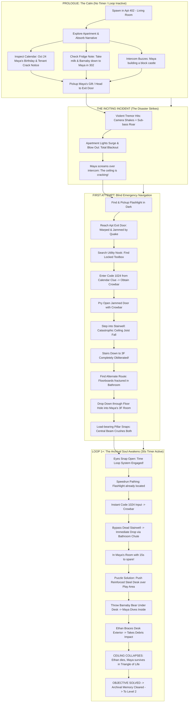
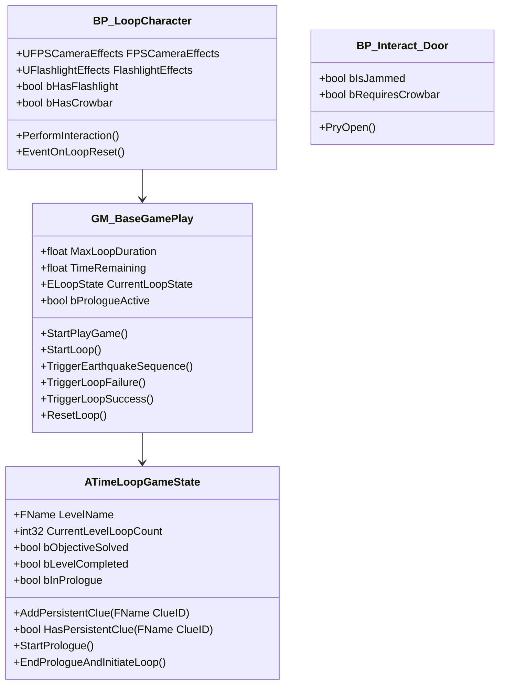

# TimeLoop: Level 1 - “The Collapse”
## Detailed Gameplay Flow, Multi-Floor Architecture & Puzzle Design

---

### Table of Contents
1. [Core Design Philosophy & Narrative Foundation](#1-core-design-philosophy--narrative-foundation)
2. [Macro Gameplay Flowchart](#2-macro-gameplay-flowchart)
3. [The Prologue: The Calm Before the Tremor (No Loops Active)](#3-the-prologue-the-calm-before-the-tremor-no-loops-active)
4. [The Inciting Incident: The Earthquake & Blackout Sequence](#4-the-inciting-incident-the-earthquake--blackout-sequence)
5. [Phase-by-Phase Gameplay & Puzzle Progression](#5-phase-by-phase-gameplay--puzzle-progression)
6. [Multi-Floor Apartment Architecture (4th Floor vs. 3rd Floor)](#6-multi-floor-apartment-architecture-4th-floor-vs-3rd-floor)
7. [The Loop Transition: Awakening The Archival Soul](#7-the-loop-transition-awakening-the-archival-soul)
8. [Subsequent Loop Optimization & Persistent Knowledge](#8-subsequent-loop-optimization--persistent-knowledge)
9. [UE5 Blueprint & C++ Technical Implementation Plan](#9-ue5-blueprint--c-technical-implementation-plan)

---

## 1. Core Design Philosophy & Narrative Foundation

### Theme: “You Are Already Dead — But They Don't Have To Be”
In *TimeLoop*, the player embodies an **Archival Soul**—an echo reliving the final moments of historical tragedies. For Level 1 (*The Collapse*), the emotional weight relies on grounding the player in a tangible human bond before the cosmic/temporal anomaly begins.

- **The Setting**: Apartment 402 (Floor 4) & Apartment 302 (Floor 3) in *The Willow Creek Tenements* (circa October 1994). Heavy autumnal rain outside, warm incandescent lighting, retro CRT humming with late-night broadcasts.
- **The Protagonist**: **Ethan**, an older brother working evening shifts to support his little sister.
- **The Child**: **Maya** (Age 7), vibrant, imaginative, currently downstairs in Unit 302 playing on a carpeted floor with hand-carved wooden blocks and her favorite rabbit plushie, **Barnaby**.
- **The Loop Rule**: **The time loop does NOT start on game launch.** The player starts in a peaceful, unhurried narrative prologue. Only after experiencing the horrifying first collapse and dying does the archival time loop awaken.

---

## 2. Macro Gameplay Flowchart



---

## 3. The Prologue: The Calm Before the Tremor (No Loops Active)

### Why this changes everything:
In traditional time-loop games, starting the countdown on frame 1 induces panic before the player cares about the space or people. By delaying the loop:
1. The player builds an **emotional stake** in Maya.
2. The player explores the geography at their own pace, building mental spatial awareness that becomes crucial once the timer starts.
3. The sudden contrast between calm domesticity and brutal seismic violence delivers immense horror and urgency.

### Narrative & Environmental Storytelling Clues:

```
+---------------------------------------------------------------------------------+
|                               APARTMENT 402 (FLOOR 4)                           |
|                                                                                 |
|   +-----------------------+     +-------------------+    +------------------+   |
|   |      KITCHEN          |     |    LIVING ROOM    |    |  UTILITY / BATH  |   |
|   |  - Fridge Memo Note   |     |  - CRT TV / Couch |    |  - Toolbox (1024)|   |
|   |  - Warm Milk on stove |     |  - Side table     |    |  - Bathroom Vent |   |
|   |  - Spare Batteries    |     |  - Radio Clue     |    |  - Fractured Planks| 
|   +-----------------------+     +-------------------+    +------------------+   |
|                                                                                 |
|                  +----------------------------------------------+               |
|                  |     CORRIDOR / ENTRYWAY                      |               |
|                  |  - Wall Calendar (Oct 24 circled)            |               |
|                  |  - Intercom / Baby Monitor                   |               |
|                  |  - Flashlight on Console Table               |               |
|                  |  - [JAMMED APARTMENT DOOR]                   |               |
|                  +----------------------------------------------+               |
+---------------------------------------------------------------------------------+
                                       |
                       (Earthquake Warps Door Frame)
                                       v
                     [STAIRWELL TO 3F: COLLAPSED IN QUAKE]
                                       |
        (Alternate Route: Drop through Bathroom Floor Gap)
                                       v
+---------------------------------------------------------------------------------+
|                               APARTMENT 302 (FLOOR 3)                           |
|                                                                                 |
|   +-------------------------------------------------------------------------+   |
|   |     MAYA'S BEDROOM / PLAY AREA                                          |   |
|   |  - Maya sitting on Play Mat playing with wooden blocks                  |   |
|   |  - "Barnaby" Teddy Bear on nearby nightstand                            |   |
|   |  - Heavy Industrial Reinforced Steel Desk (Pushable)                    |   |
|   |  - Ceiling Joists Cracking Above (Collapse Zone)                        |   |
|   |  - Exit Door to Hallway: Blocked from outside by fallen concrete        |   |
|   +-------------------------------------------------------------------------+   |
+---------------------------------------------------------------------------------+
```

#### Detailed Clue Props Placed in Apartment 402:
1. **The Wall Calendar (`Calendar_Clue`)**:
   - Location: Hallway wall next to the phone.
   - Texture / Text: October 1994 calendar. Date **October 24** has a bright red heart and marker circle: *"Maya's 7th Birthday Party! 🎉"*.
   - Below it, handwritten: *"Lockbox Code: Maya's bday (10-24)"*.
   - A yellow tenant notice pinned at the bottom: *"WARNING: Structural inspection scheduled. Ceiling joist fissures detected between 3rd and 4th floor corridors. Do not place heavy loads along the north wall."*
2. **The Kitchen Memo (`Fridge_Note`)**:
   - Location: Pinned with a magnet to the refrigerator.
   - Text: *"Ethan, don't forget to take the warm milk down to Maya in 302. She said she's finishing her wooden block castle before bedtime. Bring Barnaby bear if she's fussy."*
3. **The Baby Monitor / Intercom (`Radio_Clue`)**:
   - Location: Coffee table beside the armchair.
   - Behavior: Soft warm crackle of static. Maya's voice pipes in:
     > *"Ethan? Are you coming down? Look at my castle, it's taller than my knees! ...The light in my room keeps buzzing funny, Ethan. It's making weird clicks."*
4. **Framed Family Photograph (`Photo_Mantel`)**:
   - Location: Living room shelf next to the VHS tapes.
   - Depicts Ethan smiling, carrying Maya on his shoulders outside the building during summer.
5. **The Flashlight (`Flashlight_Pickup`)**:
   - Location: Resting on the entryway telephone table next to a set of keys.
   - In Prologue: Player can look at it, but prompt says: *"Flashlight. New batteries inside. Hopefully we won't need it tonight."*

---

## 4. The Inciting Incident: The Earthquake & Blackout Sequence

### Step-by-Step Sequence Execution:
1. **Trigger Condition**:
   - Player picks up Maya's birthday gift / drink and interacts with the front door, OR after 60 seconds of unhurried exploration.
2. **Phase 1: The Initial Tremor (t = 0.0s to 3.0s)**:
   - Deep sub-audible rumble builds through the subwoofer / bass channel.
   - Small items (books, mugs, cassettes) jitter and slide on shelves.
   - `FPSCameraEffects::PlayEarthQuakeShake(Duration = 8.0f, Intensity = 1.2f)`.
   - Ethan mutters: *"What the hell... an earthquake?"*
3. **Phase 2: Violent Structural Rupture (t = 3.0s to 6.0s)**:
   - Audio spikes with concrete crunching, tearing drywall, distant car alarms ringing outside in the rain.
   - Shake intensity jumps: `SetShakingParameters(Frequency = 8.0f, Pitch = 2.5f, Roll = 3.0f, Vertical = 6.0f)`.
   - Plaster dust streams from ceiling joists (`NS_DustMote` burst).
   - Apartment ceiling lights flicker wildly in sync with electrical sparks.
4. **Phase 3: The Blackout (t = 6.0s)**:
   - Violent electrical pop!
   - Every light actor (`BP_ArpartmentLight_C_0` to `C_10`) turns OFF simultaneously.
   - Total darkness envelopes the room, broken only by faint street lamp sodium-glow through window rain streaks.
   - Maya's terrified voice screams through the intercom:
     > *"ETHAN?! THE LIGHTS WENT OUT! SOMETHING CRASHED OUTSIDE! ETHAN, HELP ME!"*
5. **Phase 4: Emergency Transition**:
   - The game HUD switches into emergency mode.
   - Inner monologue: *"The power's out! I need to grab the flashlight and get down to Maya!"*

---

## 5. Phase-by-Phase Gameplay & Puzzle Progression

### Puzzle 1: Illuminating the Dark
- **Objective**: Locate the flashlight in zero visibility.
- **Deduction**: Player remembers the entryway table from their prologue exploration.
- **Action**: Pick up `Flashlight_Pickup`.
- **Feedback**: Crisp mechanical switch sound (`SoundSwitchOn`), activating the character's forward spot light with PS1 dithered volumetric falloff.

### Puzzle 2: The Jammed Door & The Maintenance Code
- **Objective**: Open the exit door to reach the stairwell.
- **Obstacle**: The earthquake shifted the concrete frame, wedging the wooden door tightly shut. Interacting with the handle yields a jammed latch sound and prompt: *"The frame is warped shut! I need a crowbar or heavy tool to pry it open."*
- **Clue Tracing**:
  - The calendar clue read: *"Lockbox Code: Maya's bday (10-24)"*.
  - Utility closet contains `Toolbox_Locked`.
- **Interaction**:
  - Player interacts with `Toolbox_CodeDial`.
  - Enters digits: `1 - 0 - 2 - 4`.
  - The heavy steel latches snap open. Player retrieves the **Crowbar** (`BP_Obtainable`).
- **Resolution**:
  - Player uses Crowbar on the jammed door.
  - Wood cracks and splinters with a heavy mechanical pry sound. The door swings ajar!

### Puzzle 3: The Broken Stairwell & The Vertical Alternative Route
- **The Catastrophe**:
  - Player steps out into the 4th-floor hallway toward the stairs.
  - A massive secondary tremor hits.
  - A reinforced concrete ceiling joist (`Fallen_SteelBeam_Exit`) drops with a thunderous impact, demolishing the staircase flight leading down to the 3rd floor!
  - Direct stair traversal is impossible (gaping drop filled with jagged rebar and smoking electrical wires).
- **The Environmental Clue**:
  - Maya's voice is heard echoing muffled from *directly below* through the floorboards!
  - The tenant notice warned: *"Ceiling joist fissures detected between 3rd and 4th floor corridors."*
- **Alternative Path Discovery**:
  - Player rushes back into Apartment 402's bathroom / utility laundry closet.
  - The severe shaking has collapsed the weakened floorboards under the radiator, revealing a jagged opening in the lath and plaster floor!
  - Flashlight beam pointed down reveals Maya's 3rd-floor bedroom play area directly beneath!
- **Action**:
  - Player drops through the floor fracture, landing on a mattress/rug in Apartment 302.

### Puzzle 4: The Triangle of Life (The Fatal Climax / Loop Solution)
- **The Situation in Apartment 302**:
  - Maya is curled up on her colorful play mat (`PlayMat`), surrounded by fallen toy blocks, crying hysterically.
  - Directly above her, the central load-bearing ceiling beam (`CollapseBeam`) has fractured at both anchor points, held only by twisting steel rebar groaning under immense tension.
  - You cannot carry Maya back up (the floor hole is 3 meters above).
  - Maya's room door is blocked from the outside by fallen hallway rubble.
  - **Fatal Timer**: The rebar is snapping. In 10–15 seconds, the ceiling will pancake completely.

#### Why Blind Loop 0 Fails:
On the first run, the player runs to Maya and tries to pull her away toward the door. As they reach her at t=0, the beam shears off and crushes both of them instantly.

#### The Solved Sequence (Loops 1+):
1. **Notice the Shelter**:
   - Along the north wall sits an industrial reinforced steel desk (`BP_ReinforcedDesk` / `SteelDesk_Top`).
   - A heavy oak wardrobe has tipped over, creating an angled pocket.
2. **Move the Reinforced Desk**:
   - Player sprints to the desk and pushes it across the floor (metal screeching SFX) so it overhangs Maya's play area.
3. **Lure / Protect Maya**:
   - Maya is frozen in panic. The player grabs her beloved teddy bear `Barnaby` (`Teddy_Pickup`) from the bedside table and throws/places it deep under the steel desk (`Marker_ShelterPocket`).
   - Maya dives under the desk to clutch Barnaby!
4. **The Ultimate Sacrifice (The Brace)**:
   - The desk alone might slide or buckle under the multi-ton concrete slab.
   - The player throws themselves across the open side of the desk (`Marker_BracePosition`), wedging a steel pipe / their own body to lock the shelter in place.
5. **The Collapse**:
   - The central beam snaps and plummets.
   - The slab crashes down. It smashes the outer room and crushes Ethan.
   - But beneath the triangle of life formed by the steel desk and Ethan's braced posture, Maya is completely unharmed in the void pocket!
   - Screen fades into ethereal white. Maya's crying voice fades into a solemn whisper: *"Ethan...? You saved me..."*
   - **Level Completed** -> Unlocks Level 2.

---

## 6. Multi-Floor Apartment Architecture (4th Floor vs. 3rd Floor)

The spatial design leverages two vertically aligned apartments within the level coordinates:

| Level Zone | Z-Height Range | Key Features & Puzzle Props |
|---|---|---|
| **Upper Level (Apartment 402)** | `Z = 300 to 650` | Living Room, CRT TV, Kitchen, Calendar Clue, Jammed Exit Door, Utility Closet with Locked Toolbox (Code: 1024), Crowbar, Bathroom Floor Fracture. |
| **Connecting Thresholds** | `Z = 150 to 300` | 1. Obliterated Stairwell (Hazard / Dead End).<br>2. Bathroom Drop Chute (Secret Vertical Shortcut). |
| **Lower Level (Apartment 302)** | `Z = 0 to 200` | Maya's Bedroom, Play Mat, Scattered Wooden Blocks, Teddy Bear "Barnaby", Heavy Reinforced Steel Desk, Tipped Wardrobe, Fatal Ceiling Beam Fall Zone. |

---

## 7. The Loop Transition: Awakening The Archival Soul

### How the First Reset Occurs:
```
[Ethan Dies in Blind Attempt] 
         │
         ▼
[Post-Process Glitch: Pixel Dilation + Inverted Retro Shading]
         │
         ▼
[Audio: Heartbeat Flatlines -> Harsh Cosmic Reverse Whoosh]
         │
         ▼
[Cut to Black for 1.2 Seconds]
         │
         ▼
[Whispered Voice: "Remember your purpose... Break the echo."]
         │
         ▼
[Snap Awakening in Apt 402: Ethan gasps for air, hands trembling]
         │
         ▼
[HUD: Loop Counter Reads "LOOP 01" - 30-Second Countdown Engaged]
```

---

## 8. Subsequent Loop Optimization & Persistent Knowledge

Once the loop system is born, the player does not need to repeat redundant steps because **the character and player retain memory**:

1. **Persistent Memory System (`ATimeLoopGameState`)**:
   - `HasPersistentClue("DiscoveredCode1024")`: Character can interact with the toolbox to enter the code in 1 button press without re-reading the calendar.
   - `HasPersistentClue("StairsDestroyed")`: Ethan says *"No point going to the stairs, they'll collapse. Bathroom chute is the only way."*
   - `HasPersistentClue("DeskIsShelter")`: Highlights the reinforced steel desk with a faint PS1 low-poly shimmer.
2. **Speedrun Route (Optimal 25-Second Clear)**:
   - **0s - 3s**: Grab Flashlight immediately from entry table.
   - **3s - 7s**: Sprint to Utility closet, unlock Toolbox (instant input), take Crowbar.
   - **7s - 11s**: Sprint to Bathroom, drop down through the floorboards straight into 302.
   - **11s - 17s**: Slide Reinforced Desk over the play mat.
   - **17s - 22s**: Grab Barnaby from table, toss under desk -> Maya crawls in.
   - **22s - 26s**: Stand at brace point and hold interact.
   - **30s**: Fatal beam drops -> Sacrifice successful!

---

## 9. UE5 Blueprint & C++ Technical Implementation Plan

### A. GameMode & GameState Separation



### B. Required Code & Blueprint Changes

1. **`GM_BaseGamePlay` (Blueprint / GameMode)**:
   - Change `StartPlayGame()`:
     - Check `if (bPrologueActive)`: Set `CurrentLoopState = Inactive`. Do **NOT** call `StartLoop()`.
     - Hide the timer widget on HUD during prologue.
   - Add Custom Event `TriggerEarthquakeSequence()`:
     - Call `PlayEarthQuakeShake(8.0f, 3.5f)` on `UFPSCameraEffects`.
     - Call `TurnOffAllLights()` on all `BP_ArpartmentLight` actors in level.
     - Play low-frequency rumble SFX.
     - Spawn dust emitter at ceiling coordinates.
   - Add Custom Event `InitiateFirstLoop()`:
     - Called after player's first death.
     - Sets `bPrologueActive = false`.
     - Sets `CurrentLoopState = Running`.
     - Calls `StartLoop()` with `MaxLoopDuration = 30.0f`.
     - Unhides the countdown / heartbeat tension HUD.

2. **`FlashlightEffects.cpp` (C++)**:
   - Implement `SwitchLight()`:
     - Toggle visibility of owner's `USpotLightComponent`.
     - Play `SoundSwitchOn` / `SoundSwitchOff`.
   - Expose `SetFlashlightEnabled(bool bEnabled)` to Blueprints.

3. **`BP_Interact_Door`**:
   - Add boolean `bIsJammedByQuake` (default true for exit door after quake).
   - In `EventInteract`:
     - If `bIsJammedByQuake`:
       - If player has `bHasCrowbar`:
         - Play pry wood cracking audio, play timeline rotation, set `bIsJammedByQuake = false`, set `IsOpen = true`.
         - HUD Message: *"Pried the door open!"*
       - Else:
         - Play door rattle audio.
         - HUD Message: *"Door is jammed tight in the frame. I need a crowbar."*

4. **`BP_ReinforcedDesk`**:
   - Placed on Floor 3 (`X: 630, Y: 60, Z: 80`).
   - Has interaction prompt: *"Push Desk over Play Area"*.
   - Plays timeline sliding desk to `Marker_ShelterPocket`.

5. **`BP_TargetNPC` (Maya)**:
   - States: `Playing` -> `Panicked` -> `UnderShelter`.
   - On overlap or Barnaby bear thrown into shelter pocket:
     - Plays crawling animation / moves to `Marker_ShelterPocket`.
     - Sets `bChildSheltered = true`.
